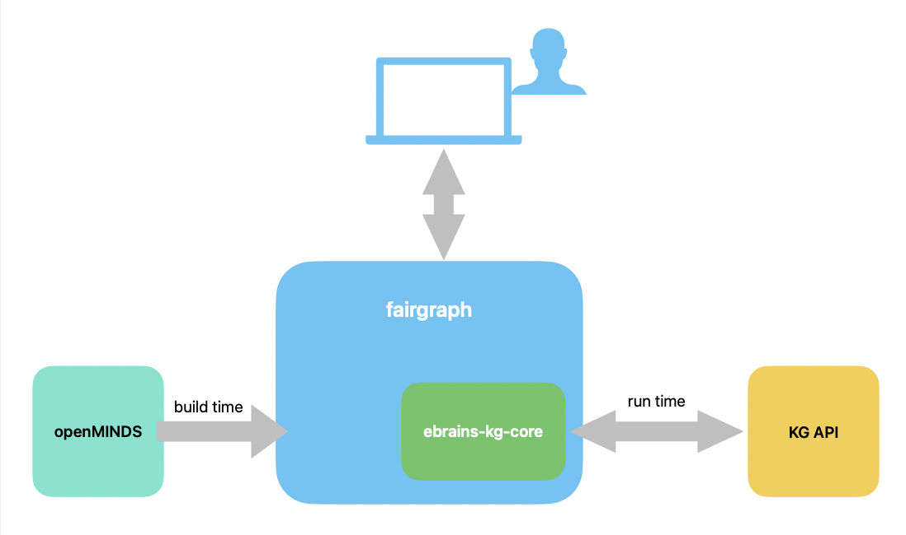

=====================
Architecture overview
=====================

This page describes how fairgraph works internally, for those who want to modify it.
You do not need to read it to use fairgraph.

         through the ebrains-kg-core library.

fairgraph builds on two other libraries:

- `openMINDS Python`_ provides a Python class for each openMINDS schema, with the schema's properties,
  validation, and serialization to and from JSON-LD;
- `ebrains-kg-core`_ is a low-level client for the KG's HTTP API.

fairgraph adds Knowledge Graph behaviour (querying, retrieving, saving, releasing) to the openMINDS classes.
It does this with a *builder* script, run by the fairgraph developers whenever openMINDS changes,
which generates a fairgraph subclass for each openMINDS class.
At run time, :class:`~fairgraph.KGClient` communicates with the KG through ``ebrains-kg-core``.

Package layout
==============

.. list-table::
   :widths: 30 70

   * - :file:`fairgraph/base.py`
     - ``Resolvable`` and ``Releasable`` mixins, the ``ErrorHandling`` enum, and the default openMINDS version
   * - :file:`fairgraph/registry.py`
     - ``NodeMeta``, the metaclass of all fairgraph classes (see `The registry`_)
   * - :file:`fairgraph/node.py`
     - ``KGNode``, the base of ``KGObject`` and ``KGEmbedded``: filter normalization, query generation,
       deserialization and existence queries
   * - :file:`fairgraph/kgobject.py`
     - :class:`~fairgraph.KGObject`, the base class for nodes with their own identity in the KG:
       ``list()``, ``from_id()``, ``exists()``, ``save()``, ``delete()``, etc.
   * - :file:`fairgraph/embedded.py`
     - :class:`~fairgraph.KGEmbedded`, the base class for nodes embedded in another node
       (e.g., ``QuantitativeValue``), which have no identity of their own
   * - :file:`fairgraph/kgproxy.py`, :file:`fairgraph/kgquery.py`
     - :class:`~fairgraph.KGProxy` and :class:`~fairgraph.KGQuery`, placeholders for links that have not yet
       been followed (see `Links`_)
   * - :file:`fairgraph/queries.py`
     - classes for building KG query definitions, and the functions that translate properties and filters
       into them
   * - :file:`fairgraph/client.py`
     - :class:`~fairgraph.KGClient`, which wraps ``ebrains-kg-core``: authentication, queries, creating,
       updating and deleting instances, spaces, and release status
   * - :file:`fairgraph/collection.py`
     - :class:`~fairgraph.Collection`, for loading and uploading groups of objects
   * - :file:`fairgraph/caching.py`
     - module-level caches of resolved objects and of the results of existence queries
   * - :file:`fairgraph/errors.py`, :file:`fairgraph/introspection.py`
     - exception classes, and functions for listing classes and setting error handling
   * - :file:`fairgraph/utility/`
     - helper functions, grouped by theme into submodules; most are re-exported from :mod:`fairgraph.utility`
   * - :file:`fairgraph/openminds/`
     - the generated classes, in :file:`v4/` and :file:`v5/`, one subpackage per openMINDS module
       (``core``, ``controlled_terms``, ``sands``, …). The hand-written :file:`__init__.py`
       makes the v4 classes also available under the shorter paths, e.g. :mod:`fairgraph.openminds.core`.
   * - :file:`builder/`
     - the builder script, :file:`update_openminds.py`, and the hand-written methods it merges into the
       generated classes

Class hierarchy
===============

The fairgraph base classes are::

                                 ┌──────── KGEmbedded
    Resolvable ─┬─ KGNode ───────┤
                │                └───┐
                │                    ├──── KGObject
                │                ┌───┘
                ├─ Releasable ───┤
                │                └──────── KGProxy
                │
                │
                └─ KGQuery

``KGObject`` inherits from both ``KGNode`` and ``Releasable``.
In addition, ``KGProxy`` is a subclass of ``openminds.base.Link``, and :class:`~fairgraph.Collection`,
which is not part of this hierarchy, is a subclass of ``openminds.Collection``.

Each generated class inherits from a fairgraph base class *and* from the corresponding openMINDS class,
e.g.:

.. code-block:: python

    from openminds.v4.core import Person as OMPerson
    from fairgraph import KGObject

    class Person(KGObject, OMPerson):
        ...

The openMINDS parent provides the schema's properties (``Person.properties``) and validation.
The fairgraph base class comes first, so that where both define a method
(e.g., ``__init__()`` or ``from_jsonld()``), fairgraph's version is used.
Nodes that have their own identity in the KG (``LinkedMetadata`` subclasses in openMINDS)
become subclasses of ``KGObject``; embedded nodes (``EmbeddedMetadata`` in openMINDS) become subclasses
of ``KGEmbedded``.

The registry
============

Properties in openMINDS Python refer to the classes they link to by name, as strings,
e.g. ``"openminds.v4.core.Organization"``.
The names are resolved to classes on first use of ``Property.types``,
by looking them up in the registry in :mod:`openminds.registry`, in which every class is registered as it is defined.

``NodeMeta`` makes each fairgraph class register under the *same name* as its openMINDS parent,
so that it replaces the openMINDS class in the registry. As a result, all links resolve to fairgraph
classes, including those in the properties that fairgraph classes inherit from openMINDS.
For example, the types of ``Affiliation.member_of`` are fairgraph's ``Consortium`` and
``Organization``, not the openMINDS ones.
The same substitution applies to lookups by type URI (:func:`openminds.registry.lookup_type`),
which is how :meth:`KGObject.from_id` finds the right class for an instance of unknown type.

This only works if each fairgraph class is defined before a property that refers to it is first used,
which is why importing :mod:`fairgraph` imports all of the generated classes.
fairgraph also converts the instances that openMINDS Python provides as class attributes
(e.g., ``Species.rattus_norvegicus``) into instances of the fairgraph classes.
Since there are many thousands of these, each class's instances are converted the first time they are used:
on import, :func:`~fairgraph.utility.register_instances` replaces them with placeholders, and accessing one of them,
or calling ``instances()`` or ``by_name()`` without a client, converts all of that class's instances
(:func:`~fairgraph.utility.recast_instances`), together with those of any other classes they link to.

Properties
==========

*Forward* properties are those defined by the openMINDS schemas; they are inherited from the openMINDS parent class.

*Reverse* properties are added by fairgraph, in the generated classes, as the ``reverse_properties`` attribute.
They represent links that point *to* an object: for example, ``Person.activities`` holds the activities
whose ``performed_by`` property refers to that person.
A reverse property is a ``Property`` whose ``reverse`` attribute gives the name of the forward property.
The builder finds every forward property that can link to a class, and names the corresponding reverse properties
using the ``reverse_name_map`` dictionary in :file:`builder/update_openminds.py`.

``cls.all_properties`` gives both forward and reverse properties.
Reverse properties are never saved, since they are stored in the KG as forward properties of other nodes.

Links
=====

Links are not followed automatically, to avoid unnecessary requests to the KG.
When an object is retrieved, each forward link is represented by a :class:`~fairgraph.KGProxy`,
holding the linked node's id and its possible types, and each reverse property is represented by a
:class:`~fairgraph.KGQuery`, holding a filter that selects the nodes that link to this object
(e.g., ``{"performed_by": <person id>}``).
Both have a ``resolve()`` method that retrieves the real object(s);
resolved objects are cached in ``fairgraph.caching.object_cache``, by id.

The ``follow_links`` argument of ``list()``, ``from_id()`` and ``resolve()`` instead retrieves linked nodes
in the same request, by including them in the query (see below).
Its nested dictionaries mirror the property names to follow.

From properties to KG queries
=============================

When filters or ``follow_links`` are given, :meth:`KGObject.list` retrieves instances with
the KG query API, which takes a query definition in JSON-LD.
``KGObject.generate_query()`` builds the definition in three passes, using the classes in :mod:`fairgraph.queries`:

1. ``generate_query_properties()`` adds a ``QueryProperty`` for each property of the class
   (via ``get_query_properties()``).
   Embedded properties become nested queries, with a ``QueryProperty`` for each property of the embedded class;
   links become a nested query for ``@id`` alone, unless they are to be followed, in which case the nested query
   includes the properties of the linked class, recursively.
   Reverse properties are included only when requested; their query paths are marked as reverse.
2. ``generate_query_filter_properties()`` adds a ``QueryProperty`` with a ``Filter`` for each filter.
   Beforehand, double-underscore names (e.g., ``developers__family_name``) are expanded into nested filters
   (``expand_filter()``), which ``normalize_filter()`` then checks against the properties,
   converting objects and values to the strings and ids that the KG expects.
3. The ``QueryProperty`` for the class's ``sort_property`` is marked for sorting.

The query is sent with each request (:meth:`KGClient.query`), rather than stored in the KG.
The results are JSON-LD documents, which ``from_jsonld()`` deserializes into objects,
with links represented as described in `Links`_.
Without filters or ``follow_links``, ``list()`` uses the simpler instances API of the KG instead.

Saving
======

:meth:`KGObject.save` first decides, with :meth:`KGObject.exists`, whether the object is already in the KG.
If the object has an id, fairgraph tries to retrieve the instance with that id
(the KG allows user-specified ids, so having an id does not mean the object has been saved).
Otherwise, it runs an *existence query*, which looks for a node of the same type whose values
for the class's ``existence_query_properties`` match those of the object
(exactly, ignoring case, or, with ``existence_match="contains"``, as substrings).
The ids found are remembered in ``fairgraph.caching.save_cache``, so that saving an equal object again
needs no query.

A new object is then created, or an existing one updated with only the properties that have changed
(or replaced entirely, with ``replace=True``).
With ``recursive=True`` (the default), linked and embedded objects are saved first, so that their ids are known.
An optional :class:`~fairgraph.utility.ActivityLog` records what was done.

The builder
===========

The classes in :file:`fairgraph/openminds/v4/` and :file:`fairgraph/openminds/v5/` are generated by
:file:`builder/update_openminds.py` from the openMINDS schemas;
see :ref:`building-openminds` for how to run it.
For each schema, the builder writes a class with:

- ``type_``, the class's type URI;
- ``default_space``, the KG space in which new instances are saved by default (from ``DEFAULT_SPACES``);
- ``reverse_properties`` (see `Properties`_);
- ``existence_query_properties`` (from ``get_existence_query()``) and ``sort_property``
  (from ``get_sort_property()``);
- an ``__init__()`` with a keyword argument for each forward and reverse property;
- any hand-written methods for the class, from :file:`builder/additional_methods/`
  (see :ref:`additional-methods`).

The builder also writes each module's :file:`__init__.py`, which provides ``list_kg_classes()`` and
``set_error_handling()`` for that module.

.. _`openMINDS Python`: https://pypi.org/project/openminds/
.. _`ebrains-kg-core`: https://pypi.org/project/ebrains-kg-core/
